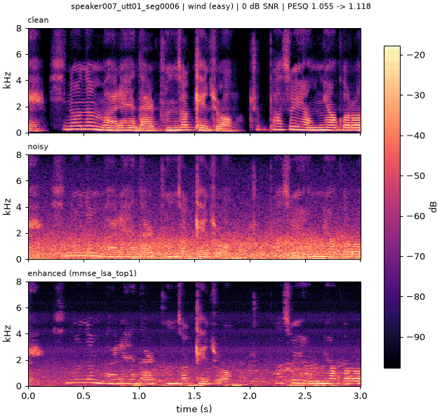
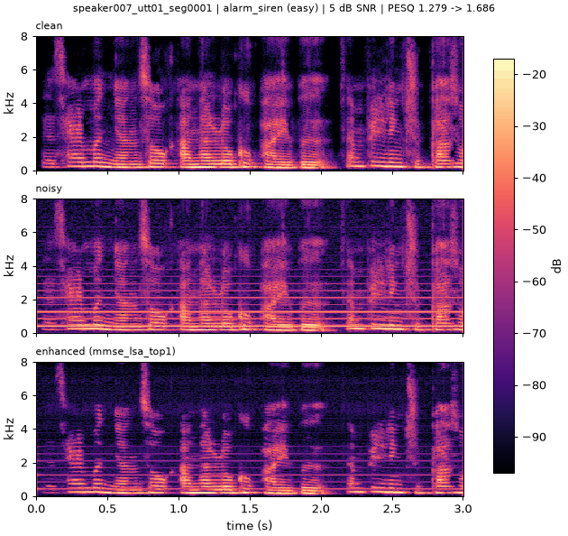
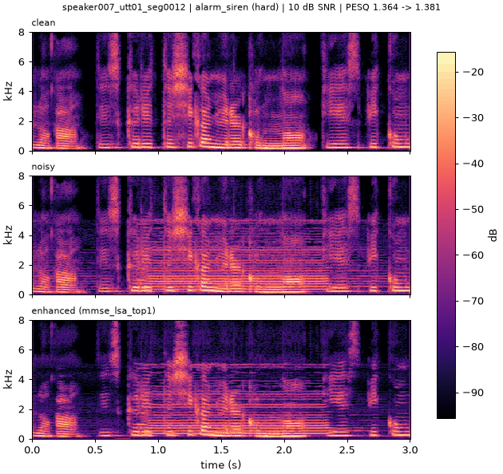
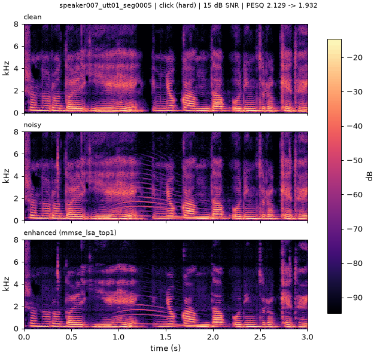

# AI 활용 보고서 — 1회차 제출 (dsp-v1)

- 소속: 연세대학교 미래캠퍼스 ____학과
- 조: 13조
- 조원: ____, ____, ____
- 프로젝트명: Speech Noise Reduction Challenge 1 ("내 목소리를 구해줘!") — 전통 신호처리 기반 음성 잡음 제거
- 제출 버전: tag `dsp-v1`, code commit `af75105`, 방법 MMSE-LSA (`configs/submission.yaml`)

---

## Part 1. AI 활용 과정

| 항목 | 내용 |
|---|---|
| 사용 AI 모델 | Claude (Anthropic) — 채팅(전략·실험 설계·결과 분석), Claude Code CLI(코드 작성·실행·평가·커밋) |
| 활용 목적 | ____ (예: 베이스라인 이식, 평가 파이프라인, MMSE-LSA 구현, 파라미터 그리드 탐색, 제출 규정 점검) |
| 작업 기록 | `docs/ai_usage_log.md` |

## Part 2. 주요 활용 사례

### 사례 1

- 나의 질문:
- AI 답변 요약:
- 나의 검증 및 수정 과정:

### 사례 2

- 나의 질문:
- AI 답변 요약:
- 나의 검증 및 수정 과정:

### 사례 3

- 나의 질문:
- AI 답변 요약:
- 나의 검증 및 수정 과정:

## Part 3. 알고리즘 이해 및 결과 분석

### 알고리즘 이해

### 개선 결과

Validation 164개 파일, PESQ-WB (`pesq==0.0.4`, 16 kHz), SNR = 과목 정의. 16-bit 출력 기준.
noisy = 처리하지 않은 입력, Wiener = 과목 베이스라인(`configs/wiener_baseline.yaml`), MMSE-LSA = 제출 버전(`main.py` 출력).
출처: `results/experiments.csv` (git ffa094e), `docs/validation_results.md`.

**PESQ**

| 방법 | 전체 | 0 dB | 5 dB | 10 dB | 15 dB |
|---|---|---|---|---|---|
| noisy | 1.3947 | 1.0796 | 1.2181 | 1.3575 | 1.6354 |
| Wiener (baseline) | 1.5987 | 1.1459 | 1.3788 | 1.5610 | 1.9062 |
| MMSE-LSA (dsp-v1) | **1.7505** | 1.1728 | 1.4687 | 1.6993 | 2.1468 |

**SNR (dB)**

| 방법 | 전체 | 0 dB | 5 dB | 10 dB | 15 dB |
|---|---|---|---|---|---|
| noisy | 9.63 | 0.00 | 5.00 | 10.00 | 15.00 |
| Wiener (baseline) | 13.12 | 6.23 | 10.08 | 13.42 | 16.74 |
| MMSE-LSA (dsp-v1) | **13.56** | 6.02 | 10.36 | 13.83 | 17.50 |

보조 검증 (val_remix, 328개, 선택에 사용하지 않음): MMSE-LSA PESQ 1.6626 / SNR 11.68 dB (noisy 1.3620 / 7.50 dB).

변경 이유:

### 스펙트로그램·청취 분석

각 목표 SNR에서 고정 규칙(정렬 순서상 첫 번째 hard 파일, 없으면 첫 번째 파일; 0 dB·5 dB에는 hard 파일이 없음)으로 고른 validation 파일 (위: clean, 가운데: noisy, 아래: MMSE-LSA). 생성: `scripts/plot_spectrograms.py --config configs/mmse_lsa_top1.yaml`.
청취용 wav: `outputs/listen/mmse_lsa_top1/` (저장소에 포함하지 않음). Wiener 비교 그림: `docs/figures/wiener_baseline_*.png`.

| 파일 | 잡음 | SNR | PESQ noisy → MMSE-LSA |
|---|---|---|---|
| speaker007_utt01_seg0006 | wind (easy) | 0 dB | 1.055 → 1.118 |
| speaker007_utt01_seg0001 | alarm_siren (easy) | 5 dB | 1.279 → 1.686 |
| speaker007_utt01_seg0012 | alarm_siren (hard) | 10 dB | 1.364 → 1.381 |
| speaker007_utt01_seg0005 | click (hard) | 15 dB | 2.129 → 1.932 |

관찰:

### 한계와 개선 방향

---

## 붙임: 참고 문헌

AI가 제시한 목록을 그대로 쓰지 않고, 팀원이 실제 존재와 서지 정보를 확인한 뒤 확인자/확인일을 기입한다. 전체 목록: `docs/references.md`.

| 제목 | 저자 | 연도 | DOI / 링크 | 활용 내용 | 확인자 | 확인일 |
|---|---|---|---|---|---|---|
| Speech enhancement using a minimum mean-square error log-spectral amplitude estimator | Y. Ephraim, D. Malah | 1985 | https://doi.org/10.1109/TASSP.1985.1164550 | MMSE-LSA 이득 (제출 방법) | | |
| Speech enhancement using a minimum-mean square error short-time spectral amplitude estimator | Y. Ephraim, D. Malah | 1984 | https://doi.org/10.1109/TASSP.1984.1164453 | decision-directed a priori SNR | | |
| Speech enhancement based on a priori signal to noise estimation | P. Scalart, J. Vieira Filho | 1996 | https://doi.org/10.1109/ICASSP.1996.543199 | Wiener 베이스라인 (DD a priori SNR) | | |
| Enhancement and bandwidth compression of noisy speech | J. S. Lim, A. V. Oppenheim | 1979 | https://doi.org/10.1109/PROC.1979.11540 | Wiener 계열 스펙트럼 이득 | | |
| Noise estimation by minima controlled recursive averaging for robust speech enhancement | I. Cohen, B. Berdugo | 2002 | https://doi.org/10.1109/97.988717 | MCRA 잡음 추정 (시도 후 제외) | | |
| SciPy 1.0: fundamental algorithms for scientific computing in Python | P. Virtanen et al. | 2020 | https://doi.org/10.1038/s41592-019-0686-2 | STFT/ISTFT, E1 (exp1) | | |
