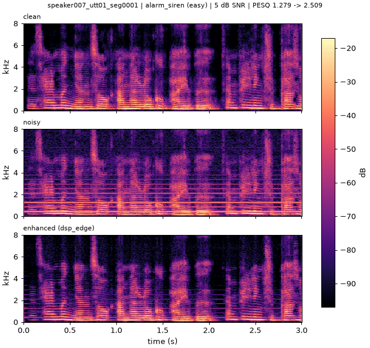
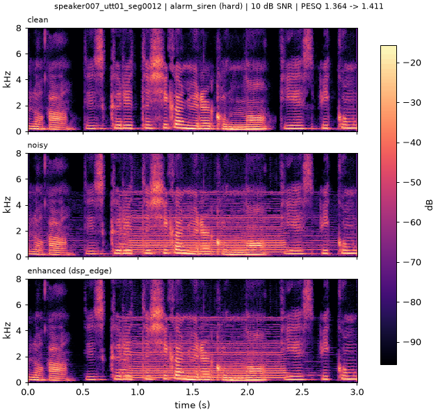
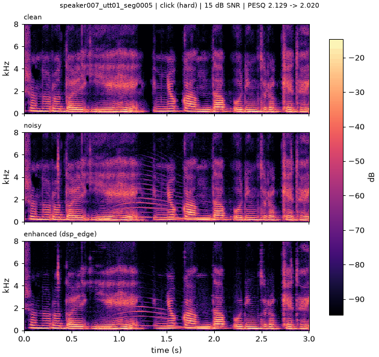

# AI 활용 보고서 — 1회차 제출 (dsp-v4)

- 소속: 연세대학교 미래캠퍼스 [ ]학과
- 조: 13조
- 조원: [ ], [ ], [ ]
- 프로젝트명: Speech Noise Reduction Challenge 1 ("내 목소리를 구해줘!") — 전통 신호처리 기반 음성 잡음 제거
- 제출 버전: tag `dsp-v4`, code commit `db1085e`, 방법 MMSE-LSA + HRNR + 100 Hz high-pass (`configs/submission.yaml` = `configs/dsp_edge.yaml` 파라미터)
- 제출일: [ ]

---

## Part 1. AI 활용 과정

| 항목 | 내용 |
|---|---|
| 사용 AI 모델 | Claude (Anthropic) — 채팅(전략·실험 설계·결과 분석), Claude Code CLI(코드 작성·실행·평가·커밋) |
| 활용 목적 | [ ] (예: 베이스라인 이식, 평가 파이프라인, MMSE-LSA 구현, 파라미터 그리드 탐색, 제출 규정 점검) |
| 작업 기록 | `docs/ai_usage_log.md` (작업마다 1행: 날짜, 목표, 핵심 프롬프트, AI가 한 일, 검증, 참고문헌) |

## Part 2. 주요 활용 사례

### 사례 1

- 나의 질문: [ ]
- AI 답변 요약: [ ]
- 나의 검증 및 수정 과정: [ ]

### 사례 2

- 나의 질문: [ ]
- AI 답변 요약: [ ]
- 나의 검증 및 수정 과정: [ ]

### 사례 3

- 나의 질문: [ ]
- AI 답변 요약: [ ]
- 나의 검증 및 수정 과정: [ ]

## Part 3. 알고리즘 이해 및 결과 분석

### 알고리즘 이해

[ ] (팀 서술)

#### 제출 방법의 처리 순서와 파라미터 (dsp-v4, `src/nrc/methods/mmse_lsa.py`, `configs/dsp_edge.yaml`)

입력 16 kHz 단일 채널 기준 (다른 샘플레이트는 16 kHz로 리샘플 후 처리하고 되돌림, 다채널은 평균 후 처리 결과를 모든 채널에 기록).

| 단계 | 내용 | 파라미터 |
|---|---|---|
| 1. STFT | Hann 창 STFT (64 ms 창 / 16 ms hop) | `n_fft: 1024`, `hop: 256`, `window: hann` |
| 2. 잡음 PSD 추정 | 파일 전체에서 에너지가 가장 낮은 10 % 프레임의 평균 파워, 주파수 방향 3 bin 평활, 잡음 bias 곱 (시불변) | `noise_est: initial`, `noise_fraction: 0.10`, `noise_bias: 1.25` |
| 3. a posteriori / 1단계 a priori SNR | gamma = \|Y\|² / 잡음 PSD; decision-directed 평활 (Ephraim & Malah 1984), 하한 적용 | `alpha: 0.94`, `xi_min_db: -25` |
| 4. HRNR (2단계 a priori SNR) | TSNR: xi = \|G_dd Y\|² / 잡음; TSNR 추정치를 재합성 → 반파 정류로 고조파 재생 → 재분석; 최종 xi = (rho \|G_tsnr Y\|² + (1 − rho) \|S_harmo\|²) / 잡음 (Plapous, Marro & Scalart 2006) | `xi_mode: hrnr`, `hrnr_rho: 0.5`, `xi_cepstral_smoothing: false` |
| 5. LSA 이득 | G = xi/(1+xi) · exp(0.5 · E1(v)), v = xi·gamma/(1+xi) (Ephraim & Malah 1985) | — |
| 6. 이득 하한 | G를 [gmin, 0 dB]로 clip; 잡음 위상 그대로, ISTFT 후 원래 길이로 자름 | `gmin_db: -30` |
| 7. 출력 high-pass | 4차 Butterworth 100 Hz, 순방향-역방향 (zero phase, `scipy.signal.butter` + `sosfiltfilt`) | `highpass_hz: 100` |
| 8. 출력 | 16-bit PCM, 입력과 같은 파일명·샘플레이트·채널 수·샘플 수 | — |

### 개선 결과

Validation 164개 파일, PESQ-WB (`pesq==0.0.4`, 16 kHz), SNR = 과목 정의, 16-bit 출력 기준. val_remix = validation clean 음성을
다른 validation 잡음과 다시 섞은 328개 (seed 1234), 선택에는 쓰지 않는 보조 검증.
출처: `results/experiments.csv` clean-hash 행 (아래 hash 열), `docs/validation_results.md`.
noisy 값은 dsp-v4 `main.py` 출력 평가 (db1085e)에서 enhanced − delta로 계산한 값 (`docs/validation_results.md`).

**PESQ / SNR 진행표**

| 버전 | 방법 (변경점) | hash | val PESQ | val SNR (dB) | val_remix PESQ | val_remix SNR (dB) |
|---|---|---|---|---|---|---|
| noisy | 처리 없음 | db1085e | 1.3947 | 9.63 | 1.3620 | 7.50 |
| Wiener (baseline) | 과목 베이스라인 (`configs/wiener_baseline.yaml`) | ffa094e | 1.5987 | 13.12 | — (미측정) | — |
| dsp-v1 | MMSE-LSA, n_fft 512, nf 0.20, alpha 0.96, xi_min −15, gmin −25 | ffa094e | 1.7505 | 13.56 | 1.6626 | 11.68 |
| dsp-v2 | + n_fft 1024, nf 0.10, noise_bias 1.25, HRNR, 100 Hz HP | e68a073 | 1.8746 | 12.64 | 1.7866 | 10.96 |
| dsp-v3 | + alpha 0.94, xi_min −20 | 7080f9b | 1.9352 | 12.71 | 1.8350 | 11.02 |
| **dsp-v4 (제출)** | + xi_min −25, gmin −30 | db1085e | **1.9497** | **12.72** | **1.8449** | **11.03** |

**목표 SNR별 PESQ (validation)**

| 버전 | 0 dB (n=15) | 5 dB (n=38) | 10 dB (n=55) | 15 dB (n=56) |
|---|---|---|---|---|
| noisy | 1.0796 | 1.2181 | 1.3575 | 1.6354 |
| Wiener (baseline) | 1.1459 | 1.3788 | 1.5610 | 1.9062 |
| dsp-v1 | 1.1728 | 1.4687 | 1.6993 | 2.1468 |
| dsp-v2 | 1.2398 | 1.5725 | 1.8446 | 2.2791 |
| dsp-v3 | 1.2727 | 1.6609 | 1.9145 | 2.3192 |
| **dsp-v4** | **1.2834** | **1.6831** | **1.9341** | **2.3245** |

**목표 SNR별 출력 SNR (dB, validation)**

| 버전 | 0 dB | 5 dB | 10 dB | 15 dB |
|---|---|---|---|---|
| noisy | 0.00 | 5.00 | 10.00 | 15.00 |
| Wiener (baseline) | 6.23 | 10.08 | 13.42 | 16.74 |
| dsp-v1 | 6.02 | 10.36 | 13.83 | 17.50 |
| dsp-v2 | 6.71 | 11.03 | 12.76 | 15.20 |
| dsp-v3 | 6.84 | 11.17 | 12.80 | 15.23 |
| **dsp-v4** | 6.87 | 11.19 | 12.81 | 15.23 |

**잡음 난이도별 (validation, dsp-v4)**

| 난이도 | n | PESQ noisy → dsp-v4 | SNR noisy → dsp-v4 (dB) |
|---|---|---|---|
| easy | 99 | 1.3112 → 1.9939 | 8.23 → 12.53 |
| moderate | 41 | 1.5161 → 1.9873 | 10.85 → 13.26 |
| hard | 24 | 1.5317 → 1.7035 | 13.33 → 12.54 |

#### PESQ–SNR trade-off (dsp-v2 단계)

- dsp-v1 → dsp-v2: validation PESQ 1.7505 → 1.8746 (+0.124), SNR 13.56 → 12.64 dB (−0.93 dB).
- 목표 SNR별 출력 SNR: 0 dB 6.02 → 6.71, 5 dB 10.36 → 11.03 (개선), 10 dB 13.83 → 12.76, 15 dB 17.50 → 15.20 (하락).
- 같은 단계의 다른 후보 dsp_tune_a (n_fft 1024 / noise_bias 1.25 / nf 0.10, HRNR·HP 없음): val PESQ 1.8085, SNR 13.73 dB.
  HRNR + 100 Hz HP를 더한 dsp_tune_c (= dsp-v2)가 PESQ는 높고 SNR은 낮음.
- 주 지표가 PESQ이므로 dsp-v2를 채택. 이후 dsp-v3/v4에서 SNR은 12.71 / 12.72 dB로 거의 유지.
- hard 잡음에서는 dsp-v4의 출력 SNR이 입력보다 낮음 (13.33 → 12.54 dB, PESQ는 +0.17).
- 원인 해석: [ ] (팀 서술; README 기록은 "high-pass와 잡음 과대추정이 음성 에너지 일부를 제거")

#### 선택 절차 (selection protocol)

- 튜닝: train에서 층화 추출한 400개 부분집합 (seed 0, `--split train --subset 400`)에서만 그리드 탐색 (`scripts/sweep.py`).
  단계: dsp_tune A (n_fft/hop, noise_bias, noise_fraction) → B (xi_mode, cepstral smoothing) → C (high-pass) → dsp_retune D1–D3
  (alpha × xi_min, noise_bias × rho, n_fft × noise_fraction) → dsp_edge E1–E2 (그리드 경계 확장, gain floor).
- 확인: 최종 후보만 validation (164개)에서 평가.
- 관문(gate): val_remix (328개)는 선택에 쓰지 않고 통과 여부만 확인.
- 수용 기준 (dsp-v2 이후 각 승격 시):
  1. train-400에서 현재 best보다 PESQ ≥ +0.005,
  2. validation PESQ ≥ 현재 best + 0.01 (dsp-v2: ≥ 1.7605, dsp-v3: ≥ 1.8846, dsp-v4: ≥ 1.9452),
  3. val_remix PESQ ≥ 현재 best의 val_remix (dsp-v4: ≥ 1.8350),
  4. 입력 레벨 probe −30/−20/−10/0 dB에서 PESQ 변동 ≤ 0.02 (dsp-v4: 1.9459/1.9509/1.9500/1.9497),
  5. `main.py` CPU < 180 s / 164 파일 (dsp-v4: 9.9 s),
  6. `scripts/e2e_check.py` PASS.
- 모든 지표는 `scripts/eval.py`만 생성하고 commit된 코드 (clean hash)로 `results/experiments.csv`에 기록.

#### 시도했으나 채택하지 않은 방법

PESQ 값은 표에 적힌 데이터에서 같은 조건으로 잰 값. "당시 best"는 그 실험 시점의 기준 설정.

| 방법 | 출처 | 브랜치 | 평가 데이터 | 시도한 방법 PESQ | 당시 best PESQ | 제외 이유 |
|---|---|---|---|---|---|---|
| MCRA 잡음 추정 | Cohen & Berdugo 2002 | exp/mmse-lsa | validation 부분집합 32개 (2026-11-05, train 튜닝 규칙 도입 전) | 1.6351 (최고점) | 1.7984 (initial 잡음 추정, 같은 sweep) | 모든 목표 SNR에서 initial보다 낮음 |
| 파일 전체 quantile 잡음 추정 | (자체 규칙) | exp/mmse-lsa | validation 전체 164개 (f4cf7c6) | 1.6683 (q 0.3, bias 1.5) | 1.7505 (mmse_lsa_top1 = dsp-v1) | −0.082; 부분집합에서도 initial nf 0.10 (1.8118)보다 낮음 (1.7163) |
| IMCRA 잡음 추정 | Cohen 2003 | exp/omlsa | train 부분집합 160개 | 1.6973 (IMCRA + LSA 최고점) | 1.7503 (dsp-v1 설정) | 모든 격자점에서 initial보다 낮음, SI-SDR 약 3 dB 낮음 |
| OM-LSA 이득 | Cohen & Berdugo 2001 | exp/omlsa | train-160 / validation / val_remix (1ffe4b2) | 1.7576 / 1.7311 / 1.6547 | 1.7503 / 1.7505 / 1.6626 (dsp-v1) | train에서만 +0.007, validation −0.019, val_remix −0.008 → 수용 기준 (val ≥ 1.7605) 미달 |
| a priori SNR의 cepstral smoothing | Breithaupt, Gerkmann & Martin 2008 | exp/dsp-tune (Stage B) | train-400 | HRNR+cep 1.8293, TSNR+cep 1.7649, DD+cep 1.6428 | 같은 xi_mode, cep 없음: 1.8436 / 1.8203 / 1.8100 | 세 xi_mode 모두에서 하락 |
| SNR 적응형 파라미터 (파일별 입력 SNR 추정 → xi_min, rho, noise_bias 보간) | (자체 규칙) | exp/dsp-adaptive | train-400 (in-sample, 4f73e0d) | 1.9120 | 1.9077 (dsp_edge = dsp-v4) | +0.0043 < 0.005 관문 → validation 평가 안 함 |
| 2-pass 잔차 잡음 재추정 (F1) | Lim & Oppenheim 1978 (아이디어) | exp/dsp-twopass | train-400 (40675e0) | 1.8985 (12점 중 최고) | 1.9077 (dsp-v4) | 12점 모두 하락 (easy −0.021, hard +0.027) |
| 이중 해상도 혼합 (F2, n_fft 512/1024 출력 가중합) | (자체 규칙) | exp/dsp-twopass | train-400 (40675e0) | 1.9073 (w 0.85) | 1.9077 (dsp-v4) | w 0.5/0.7/0.85 = 1.8902/1.9026/1.9073, w=1 (1024만)로 갈수록 증가 |

### 스펙트로그램·청취 분석

각 목표 SNR에서 고정 규칙(정렬 순서상 첫 번째 hard 파일, 없으면 첫 번째 파일; 0 dB·5 dB에는 hard 파일이 없음)으로 고른
validation 파일 (위: clean, 가운데: noisy, 아래: 처리 결과). 생성: `scripts/plot_spectrograms.py --config configs/dsp_edge.yaml`
(Wiener: `--config configs/wiener_baseline.yaml`). 청취용 wav: `outputs/listen/` (저장소에 포함하지 않음).
PESQ 출처: `outputs/submission/eval_validation_pred.csv` (dsp-v4 `main.py` 출력, noisy = PESQ − delta).

| 파일 | 잡음 | SNR | PESQ noisy → dsp-v4 |
|---|---|---|---|
| speaker007_utt01_seg0006 | wind (easy) | 0 dB | 1.055 → 1.191 |
| speaker007_utt01_seg0001 | alarm_siren (easy) | 5 dB | 1.279 → 2.509 |
| speaker007_utt01_seg0012 | alarm_siren (hard) | 10 dB | 1.364 → 1.411 |
| speaker007_utt01_seg0005 | click (hard) | 15 dB | 2.129 → 2.020 |

**0 dB — wind (easy)**

dsp-v4: 

Wiener: 

**5 dB — alarm_siren (easy)**

dsp-v4: 

Wiener: 

**10 dB — alarm_siren (hard)**

dsp-v4: 

Wiener: 

**15 dB — click (hard)**

dsp-v4: 

Wiener: 

관찰: [ ] (팀 서술: 스펙트로그램과 청취 비교)

### 한계와 개선 방향

[ ] (팀 서술)

참고 사실: hard 잡음 (n=24)은 PESQ 개선 +0.17로 가장 작고 출력 SNR이 입력보다 0.80 dB 낮음; 잡음 PSD가 파일 전체에서
시불변이라 비정상 잡음 (click, alarm_siren 등)을 따라가지 못함. 시변 잡음 추정 (MCRA, IMCRA, 2-pass)은 위 표처럼 모두 PESQ가 낮았음.

---

## 붙임: 참고 문헌

AI가 제시한 목록을 그대로 쓰지 않고, 팀원이 실제 존재와 서지 정보를 확인한 뒤 확인자/확인일을 기입한다.
**모든 DOI/링크는 AI가 기억으로 작성한 것 (from memory — verify).** 전체 목록: `docs/references.md`.

### 제출 방법에 사용

| 제목 | 저자 | 연도 | 학술지/출처 | DOI / 링크 | 활용 내용 | 확인자 | 확인일 |
|---|---|---|---|---|---|---|---|
| Speech enhancement using a minimum-mean square error short-time spectral amplitude estimator | Y. Ephraim, D. Malah | 1984 | IEEE Trans. Acoustics, Speech, and Signal Processing 32(6) | https://doi.org/10.1109/TASSP.1984.1164453 (from memory — verify) | decision-directed a priori SNR (alpha), MMSE 진폭 추정 틀 | [ ] | [ ] |
| Speech enhancement using a minimum mean-square error log-spectral amplitude estimator | Y. Ephraim, D. Malah | 1985 | IEEE Trans. Acoustics, Speech, and Signal Processing 33(2) | https://doi.org/10.1109/TASSP.1985.1164550 (from memory — verify) | LSA 이득 G = xi/(1+xi)·exp(0.5·E1(v)) | [ ] | [ ] |
| Improved signal-to-noise ratio estimation for speech enhancement | C. Plapous, C. Marro, P. Scalart | 2006 | IEEE Trans. Audio, Speech, and Language Processing 14(6) | https://doi.org/10.1109/TASL.2006.872621 (from memory — verify) | TSNR 2단계 a priori SNR, HRNR 고조파 재생 (rho) | [ ] | [ ] |
| scipy.signal.butter (SciPy 문서) | The SciPy community | [ ] | SciPy reference documentation | https://docs.scipy.org/doc/scipy/reference/generated/scipy.signal.butter.html (from memory — verify) | 100 Hz 4차 Butterworth high-pass (`sosfiltfilt`와 함께) | [ ] | [ ] |
| 과목 베이스라인 노트북 (SWE2011 신호및시스템, noise reduction challenge) — 외부 코드 | 과목 조교/교수 | 2026 | 강의 자료 (비공개) | — | Wiener 베이스라인 이식, 저에너지 프레임 잡음 추정 (제출 방법의 `noise_est: initial` 출발점) | [ ] | [ ] |

### 시도했으나 채택하지 않음

| 제목 | 저자 | 연도 | 학술지/출처 | DOI / 링크 | 활용 내용 | 확인자 | 확인일 |
|---|---|---|---|---|---|---|---|
| Noise spectrum estimation in adverse environments: improved minima controlled recursive averaging | I. Cohen | 2003 | IEEE Trans. Speech and Audio Processing 11(5) | https://doi.org/10.1109/TSA.2003.811544 (from memory — verify) | IMCRA 잡음 추정 (exp/omlsa, 제외) | [ ] | [ ] |
| Speech enhancement for non-stationary noise environments | I. Cohen, B. Berdugo | 2001 | Signal Processing 81(11) | https://doi.org/10.1016/S0165-1684(01)00128-1 (from memory — verify) | OM-LSA 이득 (exp/omlsa, 제외) | [ ] | [ ] |
| A novel a priori SNR estimation approach based on selective cepstro-temporal smoothing | C. Breithaupt, T. Gerkmann, R. Martin | 2008 | Proc. IEEE ICASSP 2008 | https://doi.org/10.1109/ICASSP.2008.4518655 (from memory — verify) | a priori SNR cepstral smoothing (Stage B, 제외) | [ ] | [ ] |
| All-pole modeling of degraded speech | J. S. Lim, A. V. Oppenheim | 1978 | IEEE Trans. Acoustics, Speech, and Signal Processing 26(3) | https://doi.org/10.1109/TASSP.1978.1163086 (from memory — verify) | 2-pass 재추정 아이디어 (exp/dsp-twopass, 제외) | [ ] | [ ] |
