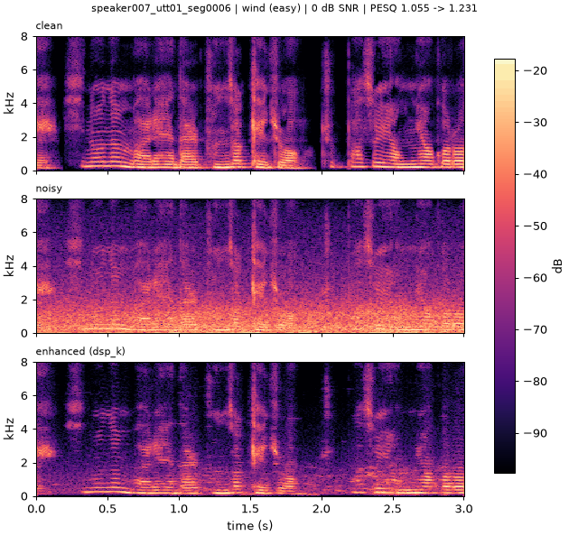
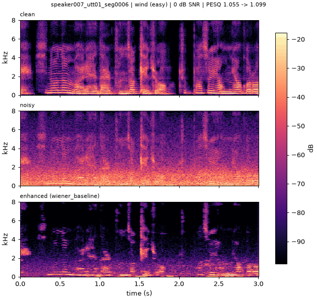
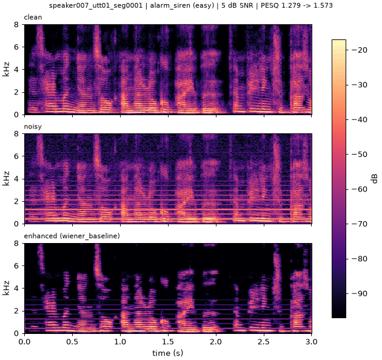
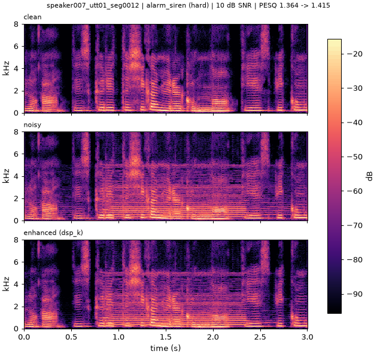
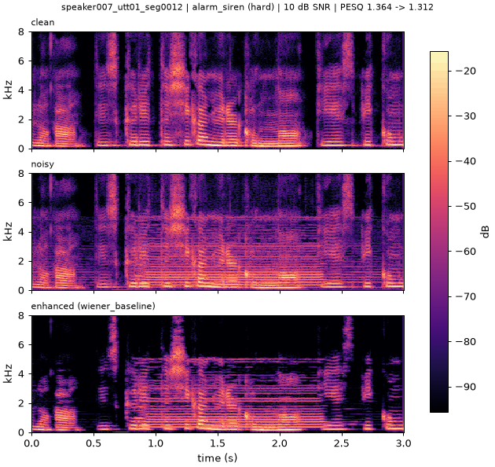
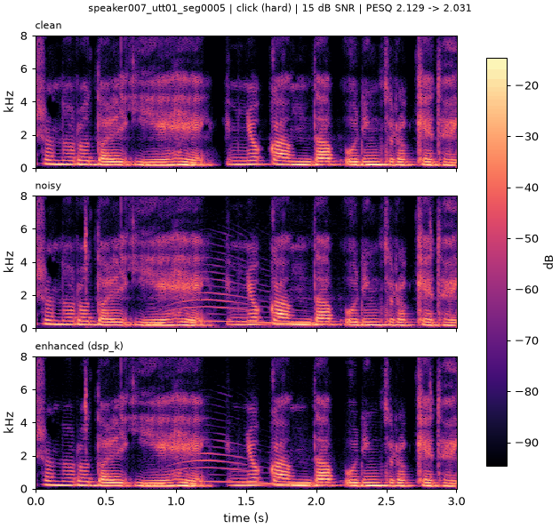
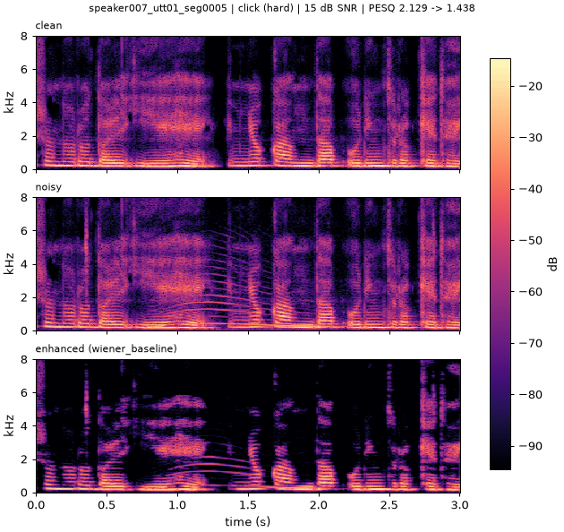

# AI 활용 보고서 — 1회차 제출 (dsp-v7)

- 소속: 연세대학교 미래캠퍼스 [ ]학과
- 조: 13조
- 조원: [ ], [ ], [ ]
- 프로젝트명: Speech Noise Reduction Challenge 1 ("내 목소리를 구해줘!") — 전통 신호처리 기반 음성 잡음 제거
- 제출 버전: tag `dsp-v7`, code commit `cdd4f07`, 방법 MMSE-LSA + HRNR + SPP 가중 파일 전체 잡음 PSD + 2대역 잡음 bias + 100 Hz high-pass (`configs/submission.yaml` = `configs/dsp_k.yaml` 파라미터)
- 제출일: [ ]

---

## Part 1. AI 활용 과정

| 항목 | 내용 |
|---|---|
| 사용 AI 모델 | Claude (Anthropic) — 채팅(전략·실험 설계·결과 분석), Claude Code CLI(코드 작성·실행·평가·커밋) |
| 활용 목적 | [ ] (예: 베이스라인 이식, 평가 파이프라인, MMSE-LSA 구현, 파라미터 그리드 탐색, oracle 진단, 제출 규정 점검) |
| 작업 기록 | `docs/ai_usage_log.md` (작업마다 1행: 날짜, 목표, 핵심 프롬프트, AI가 한 일, 검증, 참고문헌) |

## Part 2. 주요 활용 사례

### 사례 1

- 나의 질문: [ ]
- AI 답변 요약: [ ]
- 나의 검증 및 수정 과정: [ ]

### 사례 2

- 나의 질문: [ ]
- AI 답변 요약: [ ]
- 나의 검증 및 수정 과정: [ ]

### 사례 3

- 나의 질문: [ ]
- AI 답변 요약: [ ]
- 나의 검증 및 수정 과정: [ ]

## Part 3. 알고리즘 이해 및 결과 분석

### 알고리즘 이해

[ ] (팀 서술)

#### 제출 방법의 처리 순서와 파라미터 (dsp-v7, `src/nrc/methods/mmse_lsa.py`, `configs/dsp_k.yaml`)

입력 16 kHz 단일 채널 기준 (다른 샘플레이트는 16 kHz로 리샘플 후 처리하고 되돌림, 다채널은 평균 후 처리 결과를 모든 채널에 기록).

| 단계 | 내용 | 파라미터 |
|---|---|---|
| 1. STFT | Hann 창 STFT (64 ms 창 / 16 ms hop) | `n_fft: 1024`, `hop: 256`, `window: hann` |
| 2a. 초기 잡음 PSD | 파일 전체에서 에너지가 가장 낮은 10 % 프레임의 평균 파워, 주파수 방향 3 bin 평활 (bias 적용 전) = lambda_0 | `noise_fraction: 0.10` |
| 2b. SPP 가중 파일 전체 잡음 PSD | 반복 i마다 gamma = \|Y\|² / lambda_i, 사후 음성 존재 확률 P1 = 1 / (1 + (1 + xi_H1)·exp(−gamma·xi_H1 / (1 + xi_H1))) (사전확률 0.5, 고정 xi_H1; Gerkmann & Hendriks 2012), lambda_{i+1}(k) = Σ_l (1 − P1)\|Y\|² / Σ_l (1 − P1) (분모 < 1e-3이면 lambda_i 유지). 파일 전체 반복 평균은 자체 변형 (논문의 재귀 추적기가 아님). 시불변 | `noise_est: spp_mean`, `spp_iters: 3`, `spp_xi_h1_db: 10` |
| 2c. 2대역 잡음 bias | 1 kHz 아래 1.25배, 위 1.5배, 200 Hz raised-cosine 교차 (주파수 의존 과대추정; Kamath & Loizou 2002 아이디어) | `noise_bias_low: 1.25`, `noise_bias_high: 1.5` (`noise_bias: 1.25`는 2대역 설정에 의해 대체) |
| 3. a posteriori / 1단계 a priori SNR | gamma = \|Y\|² / 잡음 PSD; decision-directed 평활 (Ephraim & Malah 1984), 하한 적용 | `alpha: 0.94`, `xi_min_db: -25` |
| 4. HRNR (2단계 a priori SNR) | TSNR: xi = \|G_dd Y\|² / 잡음; TSNR 추정치를 재합성 → 반파 정류로 고조파 재생 → 재분석; 최종 xi = (rho·\|G_tsnr Y\|² + (1 − rho)·\|S_harmo\|²) / 잡음 (Plapous, Marro & Scalart 2006) | `xi_mode: hrnr`, `hrnr_rho: 0.3`, `xi_cepstral_smoothing: false` |
| 5. LSA 이득 | G = xi/(1+xi) · exp(0.5 · E1(v)), v = xi·gamma/(1+xi) (Ephraim & Malah 1985) | — |
| 6. 이득 하한·합성 | G를 [gmin, 0 dB]로 clip; 잡음 위상 그대로, ISTFT 후 원래 길이로 자름 | `gmin_db: -30` |
| 7. 출력 high-pass | 4차 Butterworth 100 Hz, 순방향-역방향 (zero phase, `scipy.signal.butter` + `sosfiltfilt`) | `highpass_hz: 100` |
| 8. 출력 | 16-bit PCM, 입력과 같은 파일명·샘플레이트·채널 수·샘플 수 | — |

### 개선 결과

Validation 164개 파일, PESQ-WB (`pesq==0.0.4`, 16 kHz), SNR = 과목 정의, 16-bit 출력 기준. val_remix = validation clean 음성을
다른 validation 잡음과 다시 섞은 328개 (seed 1234), 선택에는 쓰지 않는 보조 검증.
출처: `results/experiments.csv` clean-hash 행 (아래 hash 열), `docs/validation_results.md`, `docs/exp_dsp_{g,h,k}.md`.
noisy 값은 `main.py` 출력 평가에서 enhanced − delta로 계산한 값 (`docs/validation_results.md`).

**PESQ / SNR 진행표**

| 버전 | 변경점 (직전 버전 대비) | hash | val PESQ | val SNR (dB) | val_remix PESQ | val_remix SNR (dB) | 0 dB | 5 dB | 10 dB | 15 dB |
|---|---|---|---|---|---|---|---|---|---|---|
| noisy | 처리 없음 | cdd4f07 | 1.3947 | 9.63 | 1.3620 | 7.50 | 1.0796 | 1.2181 | 1.3575 | 1.6354 |
| Wiener (baseline) | 과목 베이스라인 (`configs/wiener_baseline.yaml`) | ffa094e | 1.5987 | 13.12 | — (미측정) | — | 1.1459 | 1.3788 | 1.5610 | 1.9062 |
| dsp-v1 | MMSE-LSA, n_fft 512, nf 0.20, alpha 0.96, xi_min −15, gmin −25 | ffa094e | 1.7505 | 13.56 | 1.6626 | 11.68 | 1.1728 | 1.4687 | 1.6993 | 2.1468 |
| dsp-v2 | n_fft 1024, nf 0.10, noise_bias 1.25, HRNR (rho 0.5), 100 Hz HP | e68a073 | 1.8746 | 12.64 | 1.7866 | 10.96 | 1.2398 | 1.5725 | 1.8446 | 2.2791 |
| dsp-v3 | alpha 0.94, xi_min −20 | 7080f9b | 1.9352 | 12.71 | 1.8350 | 11.02 | 1.2727 | 1.6609 | 1.9145 | 2.3192 |
| dsp-v4 | xi_min −25, gmin −30 (그리드 경계 확장) | db1085e | 1.9497 | 12.72 | 1.8449 | 11.03 | 1.2834 | 1.6831 | 1.9341 | 2.3245 |
| dsp-v5 | hrnr_rho 0.5 → 0.3 (G5) | fb1d2dc | 1.9570 | 12.69 | 1.8500 | 11.02 | 1.2900 | 1.6939 | 1.9385 | 2.3323 |
| dsp-v6 | 2대역 잡음 bias 1.25 / 1.5 (1 kHz 분할) (H3) | d9d1be6 | 1.9637 | 12.70 | 1.8524 | 11.04 | 1.2960 | 1.6994 | 1.9486 | 2.3368 |
| **dsp-v7 (제출)** | SPP 가중 파일 전체 잡음 PSD, 3회 / xi_H1 10 dB (K1) | cdd4f07 | **1.9884** | **12.84** | **1.8942** | **11.20** | **1.3311** | **1.7486** | **1.9591** | **2.3559** |

0/5/10/15 dB 열 = 목표 SNR별 validation PESQ (n = 15 / 38 / 55 / 56).

**목표 SNR별 출력 SNR (dB, validation)**

| 버전 | 0 dB | 5 dB | 10 dB | 15 dB |
|---|---|---|---|---|
| noisy | 0.00 | 5.00 | 10.00 | 15.00 |
| Wiener (baseline) | 6.23 | 10.08 | 13.42 | 16.74 |
| dsp-v1 | 6.02 | 10.36 | 13.83 | 17.50 |
| dsp-v2 | 6.71 | 11.03 | 12.76 | 15.20 |
| dsp-v3 | 6.84 | 11.17 | 12.80 | 15.23 |
| dsp-v4 | 6.87 | 11.19 | 12.81 | 15.23 |
| dsp-v5, dsp-v6 | — (문서에 미기록) | — | — | — |
| **dsp-v7** | 6.86 | 11.45 | 12.90 | 15.32 |

**잡음 난이도별 (validation, dsp-v7)**

| 난이도 | n | PESQ noisy → dsp-v7 | SNR noisy → dsp-v7 (dB) |
|---|---|---|---|
| easy | 99 | 1.3112 → 2.0367 | 8.23 → 12.63 |
| moderate | 41 | 1.5161 → 2.0202 | 10.85 → 13.46 |
| hard | 24 | 1.5317 → 1.7348 | 13.33 → 12.61 |

#### PESQ–SNR trade-off

- dsp-v1 → dsp-v2: validation PESQ 1.7505 → 1.8746 (+0.124), SNR 13.56 → 12.64 dB (−0.93 dB).
- 목표 SNR별 출력 SNR: 0 dB 6.02 → 6.71, 5 dB 10.36 → 11.03 (개선), 10 dB 13.83 → 12.76, 15 dB 17.50 → 15.20 (하락).
- 같은 단계의 다른 후보 dsp_tune_a (n_fft 1024 / noise_bias 1.25 / nf 0.10, HRNR·HP 없음): val PESQ 1.8085, SNR 13.73 dB.
  HRNR + 100 Hz HP를 더한 dsp_tune_c (= dsp-v2)가 PESQ는 높고 SNR은 낮음.
- 주 지표가 PESQ이므로 dsp-v2를 채택. 이후 dsp-v3 ~ v6에서 SNR은 12.69 ~ 12.72 dB, dsp-v7에서 12.84 dB.
- dsp-v7 전체 기준 dsp-v1 대비 PESQ +0.238, SNR −0.72 dB.
- hard 잡음에서는 dsp-v7의 출력 SNR이 입력보다 낮음 (13.33 → 12.61 dB, PESQ는 +0.20).
- 원인 해석: [ ] (팀 서술; README 기록은 "high-pass와 잡음 과대추정이 음성 에너지 일부를 제거")

#### 선택 절차 (selection protocol)

- 튜닝: train에서 층화 추출한 400개 부분집합 (seed 0, `--split train --subset 400`)에서만 그리드 탐색 (`scripts/sweep.py`).
  단계: dsp_tune A (n_fft/hop, noise_bias, noise_fraction) → B (xi_mode, cepstral smoothing) → C (high-pass) → dsp_retune D1–D3
  (alpha × xi_min, noise_bias × rho, n_fft × noise_fraction) → dsp_edge E1–E2 (그리드 경계 확장, gain floor)
  → dsp_g G1–G6 → dsp_h H1–H3 → dsp_k K1–K3 → dsp_l L1–L3 → dsp_m M1–M2.
- 단계별 paired keep 규칙 (dsp_g부터): 각 단계는 그때까지 채택한 값에서 시작하고, 격자점마다 단계 기준 설정 대비 파일별
  paired PESQ 차이 d와 SE = std/√n을 계산. d ≥ 0.002 **그리고** d ≥ 2·SE일 때만 채택. 최고점이 격자 경계면 표시 (edge flag).
- 최종 후보 (finalist) 확인 순서:
  1. 전체 train (n = 1296) paired z-test: d ≥ 0.003 그리고 z = d/SE ≥ 3,
  2. validation (164개) PESQ ≥ 현재 best,
  3. val_remix (328개) PESQ ≥ 현재 best — 관문(gate)으로만 사용, 선택에는 쓰지 않음,
  4. 입력 레벨 probe −30/−20/−10/0 dB 각각 PESQ ≥ 현재 best − 0.02 (dsp-v7: 1.9840/1.9900/1.9887/1.9884),
  5. `main.py` CPU < 180 s / 164 파일 (dsp-v7: 13.7 s),
  6. `scripts/e2e_check.py` PASS.
- 규칙 개정 (2026-11-11, `docs/exp_dsp_g.md`): 이전 규칙은 고정 여유 (train-400 ≥ +0.005, 전체 train d ≥ 0.005, validation ≥ 현재 best + 0.01).
  - 이유: 고정 여유는 후보 간 차이가 PESQ 0.1 단위이고 비교가 unpaired일 때 정한 값. 전체 1296개 train 파일의 paired 차이에서는
    단일 파라미터 변경의 SE가 약 0.001이라 z-test가 0.005보다 훨씬 작은 효과를 구분함. 고정 0.005 여유는 이 크기의 실제적이고
    일관된 이득을 기각함. 0.003 하한은 무시할 만한 효과를 걸러내고, validation / val_remix / probe / CPU 점검은 유지.
  - 주의: 규칙은 dsp_g 결과를 본 뒤 개정되었고 dsp_g가 새 규칙으로 처음 승격된 후보 (dsp-v5). dsp_g의 val (+0.0072 ± 0.0017 paired)과
    val_remix (+0.0051 ± 0.0011 paired) 이득은 둘 다 양수이고 유의함.
- 모든 지표는 `scripts/eval.py`만 생성하고 commit된 코드 (clean hash)로 `results/experiments.csv`에 기록.

**승격 단계별 전체 train paired 차이 (n = 1296, 직전 버전 대비)**

| 버전 | d ± SE (z) | val paired | val_remix paired |
|---|---|---|---|
| dsp-v5 (dsp_g) | +0.0032 ± 0.0009 (3.67) | +0.0072 ± 0.0017 | +0.0051 ± 0.0011 |
| dsp-v6 (dsp_h) | +0.0049 ± 0.0011 (4.45) | +0.0067 ± 0.0020 | +0.0024 ± 0.0015 |
| dsp-v7 (dsp_k) | +0.0302 ± 0.0039 (7.70) | +0.0247 ± 0.0099 | +0.0418 ± 0.0081 |

#### 바로잡은 가정 (corrected assumption)

- 가정: oracle 진단 (`docs/exp_oracle.md`) 직후 우리는 저에너지 10 % 프레임 잡음 PSD가 실제 평균 잡음 PSD를 **과소추정**한다고 가정했음
  (당시 PSD 자체는 측정하지 않음).
- 측정: `scripts/oracle_eval.py --lsd-grid`로 bias 적용 전 PSD를 oracle 평균 \|N\|²와 비교 (train-400, 100 Hz–8 kHz).
  dsp-v6 추정은 LSD 8.28 dB, signed bias **+4.56 dB** (과대추정). 저에너지 프레임에도 음성이 남아 있음 (음성이 대부분의 프레임을 채움).
- 결과: 과대추정의 원인 (음성 오염)을 줄이는 방향으로 SPP 가중 추정을 도입. spp_mean 3회 / 10 dB에서 LSD 5.82 dB, bias +1.37 dB
  → K1 채택 (dsp-v7).
- 후속 (dsp_l L1): 반복을 늘려 bias를 0 dB 근처로 낮추면 LSD는 줄지만 PESQ는 떨어짐. 현재 2대역 bias 1.25 / 1.5에서는 남은 +1.4 dB가
  유용한 과대 감산으로 작용하는 것으로 보임.

#### 시도했으나 채택하지 않은 방법

PESQ 값은 표에 적힌 데이터에서 같은 조건으로 잰 값. "당시 best"는 그 실험 시점의 기준 설정.
d ± SE = 단계 기준 대비 파일별 paired PESQ 차이 (train-400, seed 0).

| 방법 | 출처 | 브랜치 | 평가 데이터 | 시도한 방법 PESQ / d ± SE | 당시 best PESQ | 제외 이유 |
|---|---|---|---|---|---|---|
| MCRA 잡음 추정 | Cohen & Berdugo 2002 | exp/mmse-lsa | validation 부분집합 32개 (2026-11-05, train 튜닝 규칙 도입 전) | 1.6351 (최고점) | 1.7984 (initial 잡음 추정, 같은 sweep) | 모든 목표 SNR에서 initial보다 낮음 |
| 파일 전체 quantile 잡음 추정 | (자체 규칙) | exp/mmse-lsa | validation 전체 164개 (f4cf7c6) | 1.6683 (q 0.3, bias 1.5) | 1.7505 (mmse_lsa_top1 = dsp-v1) | −0.082; 부분집합에서도 initial nf 0.10 (1.8118)보다 낮음 (1.7163) |
| IMCRA 잡음 추정 | Cohen 2003 | exp/omlsa | train 부분집합 160개 | 1.6973 (IMCRA + LSA 최고점) | 1.7503 (dsp-v1 설정) | 모든 격자점에서 initial보다 낮음, SI-SDR 약 3 dB 낮음 |
| OM-LSA 이득 | Cohen & Berdugo 2001 | exp/omlsa | train-160 / validation / val_remix (1ffe4b2) | 1.7576 / 1.7311 / 1.6547 | 1.7503 / 1.7505 / 1.6626 (dsp-v1) | train에서만 +0.007, validation −0.019, val_remix −0.008 → 수용 기준 (val ≥ 1.7605) 미달 |
| a priori SNR의 cepstral smoothing | Breithaupt, Gerkmann & Martin 2008 | exp/dsp-tune (Stage B) | train-400 | HRNR+cep 1.8293, TSNR+cep 1.7649, DD+cep 1.6428 | 같은 xi_mode, cep 없음: 1.8436 / 1.8203 / 1.8100 | 세 xi_mode 모두에서 하락 |
| SNR 적응형 파라미터 (파일별 입력 SNR 추정 → xi_min, rho, noise_bias 보간) | (자체 규칙) | exp/dsp-adaptive | train-400 (in-sample, 4f73e0d) | 1.9120 | 1.9077 (dsp_edge = dsp-v4) | +0.0043 < 0.005 관문 → validation 평가 안 함 |
| 2-pass 잔차 잡음 재추정 (F1) | Lim & Oppenheim 1978 (아이디어) | exp/dsp-twopass | train-400 (40675e0) | 1.8985 (12점 중 최고) | 1.9077 (dsp-v4) | 12점 모두 하락 (easy −0.021, hard +0.027) |
| 이중 해상도 혼합 (F2, n_fft 512/1024 출력 가중합) | (자체 규칙) | exp/dsp-twopass | train-400 (40675e0) | 1.9073 (w 0.85) | 1.9077 (dsp-v4) | w 0.5/0.7/0.85 = 1.8902/1.9026/1.9073, w=1 (1024만)로 갈수록 증가 |
| G1 high-pass 150 Hz | (자체 규칙) | exp/dsp-g | train-400 (22ab5b0) | d +0.0078 ± 0.0039 (z 1.97) | 100 Hz (dsp-v4) | z < 2; train-400 SI-SDR 11.35 → 6.44 dB |
| G2 창 / hop (hop_div {4,8} × hann/hamming/blackman) | (자체 규칙) | exp/dsp-g | train-400 | 최고 4/blackman d −0.0003 ± 0.0020; hop_div 8 ≈ −0.02 | hann / hop 256 | 개선 없음 |
| G3 잡음 PSD 주파수 평활 ({0,1,2,4} bin × mean/median) | (자체 규칙) | exp/dsp-g | train-400 | 최고 1/median d −0.0045 ± 0.0007 | 0 (추가 평활 없음) | 모든 점 하락 |
| G4 대역별 저에너지 프레임 선택 (noise_select_bands {1,2,4,8}) | (자체 규칙) | exp/dsp-g | train-400 | 2 대역 d −0.0240 ± 0.0090 | 1 대역 | 하락 |
| H1 beta-order MMSE 이득 | You, Koh & Rahardja 2005 | exp/dsp-h | train-400 (666e86e) | 최고 beta 0.5 d −0.0124 ± 0.0028; −0.5: −0.0133 ± 0.0030; 1.0 (STSA): −0.0489 ± 0.0055 | LSA (beta → 0, dsp-v5) | 모든 점 하락, LSA가 내부 최적 |
| H2 pause expander (thr {3,6} × att {4,8} × release {4,8}) | (자체 설계) | exp/dsp-h | train-400 | 최고 6/4/4 d +0.0040 ± 0.0020 (z 1.98) | off (dsp-v5) | z < 2; att 8은 모두 −0.014 ~ −0.023; 최고점이 격자 모서리 (확장 안 함) |
| K2 시변 local-minimum 상향 보정 (tv_noise, W {8,16,32} × tv_bias {1,1.5,2}) | Martin 2001 (아이디어) | exp/dsp-k | train-400 (b21bb64) | 최고 W 32 / 1.0 d −0.2148 ± 0.0129; 모든 점 −0.21 ~ −0.50 | K1 (spp_mean) | ±0.13 ~ 0.5 s 최소값이 지속 유성음 구간에서 음성 에너지에 걸려 음성 아래 잡음 PSD를 부풀림; 손실이 SNR과 함께 커짐 (0 dB −0.035, 15 dB −0.300) |
| dsp_l (L3 2대역 bias 1.0 / 1.75; L1 spp 반복·xi_H1, L2 prior는 유지) | Gerkmann & Hendriks 2012 (prior), Kamath & Loizou 2002 | exp/dsp-l | 전체 train / validation / val_remix (499f3eb, 5b6fbf6) | 전체 train d +0.0072 ± 0.0013 (z 5.46); val 1.9915 (paired +0.0031 ± 0.0036); val_remix **1.8935** (paired −0.0007 ± 0.0024) | dsp-v7: val 1.9884, val_remix 1.8942 | **val_remix 관문 미달** (−0.0007); moderate 잡음 val_remix −0.0103 ± 0.0041 (z −2.5); L3 최고점이 두 격자 경계 |
| M1 STFT consistency 위상 (P1, K {1,3} × g {0.3,0.6,1.0}) | Griffin & Lim 1984; Le Roux & Vincent 2013 | exp/dsp-m | train-400 (9869fda) | 최고 K 1 / g 0.3 d −0.0079 ± 0.0006 (z −12.3) | dsp-v7 (train-400 1.9511) | 모든 점 하락, K·g가 클수록 손실 증가; 이득 변화가 큰 (−30 dB 하한) 크기 스펙트럼에 consistency를 강제하면 잔여 잡음이 번짐 |
| M2 고조파 위상 재구성 (P2, YIN f0, re-anchor on; g × beta × bins) | Krawczyk & Gerkmann 2014; de Cheveigné & Kawahara 2002 | exp/dsp-m | train-400 (9869fda) | 최고 g 0.6 / beta 0.5 / bins 2 d +0.0016 ± 0.0004 (z 4.0) | dsp-v7 (train-400 1.9511) | 유의하지만 d < 0.002 keep 하한; 최고점이 세 파라미터 모두 격자 경계; 바뀌는 bin 비율이 작음. 합성 위상 테스트는 PASS (0.099 rad < 0.3) |

M3 (phase_reanchor on/off)는 M2에서 채택된 값이 없어 실행하지 않음 (P2 off에서는 효과 없음).

### Oracle 진단 (oracle diagnostics)

**분석 전용.** `scripts/oracle_eval.py`는 clean 음성과 실제 잡음 n = noisy − clean을 읽어 oracle 변형을 만든다. clean 음성은 이 분석에만
사용했고 제출 코드에는 쓰지 않았다: 이 스크립트는 방법이 아니며 `src/nrc/methods`나 registry에 없고 `main.py`가 import하지 않는다.
결과는 `logs/oracle_*` (git 제외)에 있고 `results/experiments.csv`에는 없다.

설정: oracle 부분 외에는 configs/dsp_h.yaml (dsp-v6)과 동일 (STFT, DD → TSNR → HRNR LSA 이득, gmin/xi_min, 100 Hz zero-phase high-pass,
16-bit 양자화). 스크립트 hash ef94042. O0는 eval.py dsp_h 행을 그대로 재현 (validation 1.9637 / 12.70 dB; train-400 파일별 최대 차이 0),
스크립트의 이득 체인 재구현은 등록된 방법과 bit-exact.

| 변형 | 정의 |
|---|---|
| O0 | dsp-v6 그대로 |
| O1_b1 / O1_b2 | oracle 시불변 잡음 PSD = 파일 전체 bin별 \|N(k,l)\|² 평균; bias 1.0 / dsp-v6 2대역 1.25–1.5 |
| O2_b1 / O2_b2 | oracle 시변 잡음 PSD = \|N(k,l)\|²의 ±2 프레임 평균; bias 1.0 / 2대역 |
| O3 | dsp-v6 이득 × \|Y\|, clean STFT 위상 |
| O4 | ideal Wiener mask \|S\|²/(\|S\|²+\|N\|²) (noisy 위상), 이후 high-pass |
| O5_b1 / O5_b2 | O2_b1 / O2_b2 이득 + clean STFT 위상 |

**Validation (n = 164)**

| 변형 | PESQ | 0 dB | 5 dB | 10 dB | 15 dB | easy (99) | moderate (41) | hard (24) | SNR dB | O0 대비 paired d ± SE |
|---|---|---|---|---|---|---|---|---|---|---|
| O0 | 1.9637 | 1.2960 | 1.6994 | 1.9486 | 2.3368 | 2.0100 | 1.9892 | 1.7293 | 12.70 | — |
| O1_b1 | 2.1733 | 1.4245 | 1.9372 | 2.1402 | 2.5666 | 2.1859 | 2.2392 | 2.0087 | 13.88 | +0.2096 ± 0.0171 |
| O1_b2 | 2.2342 | 1.4643 | 1.9732 | 2.2069 | 2.6442 | 2.2223 | 2.3234 | 2.1306 | 13.87 | +0.2704 ± 0.0188 |
| O2_b1 | 2.6704 | 1.7215 | 2.2625 | 2.7077 | 3.1646 | 2.4741 | 2.8500 | 3.1732 | 14.81 | +0.7066 ± 0.0397 |
| O2_b2 | 2.6099 | 1.6698 | 2.1909 | 2.6436 | 3.1130 | 2.4076 | 2.7963 | 3.1263 | 14.57 | +0.6462 ± 0.0399 |
| O3 | 2.2497 | 1.4614 | 1.9371 | 2.2444 | 2.6782 | 2.3054 | 2.2805 | 1.9675 | 14.11 | +0.2860 ± 0.0117 |
| O4 | 3.4592 | 2.8320 | 3.2112 | 3.4909 | 3.7644 | 3.3254 | 3.5346 | 3.8822 | 15.99 | +1.4955 ± 0.0443 |
| O5_b1 | 3.1044 | 2.0447 | 2.6869 | 3.1718 | 3.6054 | 2.8954 | 3.3334 | 3.5757 | 16.16 | +1.1407 ± 0.0412 |
| O5_b2 | 2.9998 | 1.9460 | 2.5655 | 3.0648 | 3.5131 | 2.7845 | 3.2352 | 3.4861 | 15.69 | +1.0361 ± 0.0414 |

**원인별 차이 (paired PESQ, 평균 ± SE)**

| 차이 | Validation | Train-400 |
|---|---|---|
| (a) 시불변 잡음 추정, O1_b1 − O0 (O1_b2 − O0) | +0.210 ± 0.017 (+0.270 ± 0.019) | +0.244 ± 0.016 (+0.296 ± 0.016) |
| (b) 잡음 비정상성, O2_b1 − O1_b1 (O2_b2 − O1_b2) | +0.497 ± 0.036 (+0.376 ± 0.032) | +0.458 ± 0.023 (+0.352 ± 0.022) |
| (c) 위상, O3 − O0 | +0.286 ± 0.012 | +0.260 ± 0.007 |
| O2 크기 위의 위상, O5_b1 − O2_b1 | +0.434 ± 0.012 | +0.396 ± 0.008 |
| 크기만의 상한 O4 (절대값; O0 대비 d) | 3.459 (+1.496) | 3.391 (+1.476) |

각 차이는 자신의 기준 대비로 측정했으며 더해지지 않음. O2는 ±2 프레임의 실제 잡음 periodogram을 쓰므로 잡음 실현값 자체를 알고 있는
상한이며, blind 추적기로는 도달할 수 없음.

이후 실험과의 연결:
- (a) 시불변 추정 → dsp_k (K1 SPP 가중 추정 채택, dsp-v7, val +0.025), dsp_l (추가 조정, val_remix 관문 미달).
- (b) 비정상성 → K2 시변 local-minimum 보정 (모든 점 −0.21 이하로 제외).
- (c) 위상 → dsp_m M1 / M2 (채택 없음).

### 스펙트로그램·청취 분석

각 목표 SNR에서 고정 규칙(정렬 순서상 첫 번째 hard 파일, 없으면 첫 번째 파일; 0 dB·5 dB에는 hard 파일이 없음)으로 고른
validation 파일 (위: clean, 가운데: noisy, 아래: 처리 결과). 생성: `scripts/plot_spectrograms.py --config configs/dsp_k.yaml`
(Wiener: `--config configs/wiener_baseline.yaml`). 청취용 wav: `outputs/listen/` (저장소에 포함하지 않음).
파일별 PESQ: `outputs/submission/eval_validation_pred.csv` (dsp-v7 `main.py` 출력)에서 [ ] (팀 기입).

| 파일 | 잡음 | SNR |
|---|---|---|
| speaker007_utt01_seg0006 | wind (easy) | 0 dB |
| speaker007_utt01_seg0001 | alarm_siren (easy) | 5 dB |
| speaker007_utt01_seg0012 | alarm_siren (hard) | 10 dB |
| speaker007_utt01_seg0005 | click (hard) | 15 dB |

**0 dB — wind (easy)**

dsp-v7: 

Wiener: 

**5 dB — alarm_siren (easy)**

dsp-v7: 

Wiener: 

**10 dB — alarm_siren (hard)**

dsp-v7: 

Wiener: 

**15 dB — click (hard)**

dsp-v7: 

Wiener: 

관찰: [ ] (팀 서술: 스펙트로그램과 청취 비교)

### 한계와 개선 방향

[ ] (팀 서술)

참고 사실:
- hard 잡음 (validation n=24)은 PESQ 개선 +0.20으로 가장 작고 출력 SNR이 입력보다 0.72 dB 낮음.
- dsp-v7의 SPP 추정은 전체 train hard에서 dsp-v6 대비 −0.017 ± 0.007 (n=195, 유의); validation hard +0.006 ± 0.025, val_remix hard +0.016 ± 0.015.
- 잡음 PSD가 파일 전체에서 시불변이라 비정상 잡음 (click, bell, alarm_siren 등)을 따라가지 못함. oracle 진단에서 비정상성 차이 (b)가
  가장 큼 (val +0.38 ~ +0.50). 시도한 시변 잡음 추정 (MCRA, IMCRA, 2-pass, K2 local-minimum)은 모두 PESQ가 낮았음.
- 위상 차이 (c) +0.29 (val)는 고전적 방법 (M1, M2)으로 거의 회수하지 못함.
- dsp_l 후속 메모: 남은 시불변 상한과의 차이는 평균 PSD 수준보다 이득 규칙이나 잡음 종류 적응형 bias 쪽에 있을 것으로 봄 (미검증).

---

## 붙임: 참고 문헌

AI가 제시한 목록을 그대로 쓰지 않고, 팀원이 실제 존재와 서지 정보를 확인한 뒤 확인자/확인일을 기입한다.
**모든 DOI/링크는 AI가 기억으로 작성한 것 (from memory — verify).** 전체 목록: `docs/references.md` (dsp-m 위상 문헌은 브랜치 exp/dsp-m의 `docs/references.md`).

### 제출 방법에 사용

| 제목 | 저자 | 연도 | 학술지/출처 | DOI / 링크 | 활용 내용 | 확인자 | 확인일 |
|---|---|---|---|---|---|---|---|
| Speech enhancement using a minimum-mean square error short-time spectral amplitude estimator | Y. Ephraim, D. Malah | 1984 | IEEE Trans. Acoustics, Speech, and Signal Processing 32(6) | https://doi.org/10.1109/TASSP.1984.1164453 (from memory — verify) | decision-directed a priori SNR (alpha), MMSE 진폭 추정 틀 | [ ] | [ ] |
| Speech enhancement using a minimum mean-square error log-spectral amplitude estimator | Y. Ephraim, D. Malah | 1985 | IEEE Trans. Acoustics, Speech, and Signal Processing 33(2) | https://doi.org/10.1109/TASSP.1985.1164550 (from memory — verify) | LSA 이득 G = xi/(1+xi)·exp(0.5·E1(v)) | [ ] | [ ] |
| Improved signal-to-noise ratio estimation for speech enhancement | C. Plapous, C. Marro, P. Scalart | 2006 | IEEE Trans. Audio, Speech, and Language Processing 14(6) | https://doi.org/10.1109/TASL.2006.872621 (from memory — verify) | TSNR 2단계 a priori SNR, HRNR 고조파 재생 (rho) | [ ] | [ ] |
| Unbiased MMSE-based noise power estimation with low complexity and low tracking delay | T. Gerkmann, R. C. Hendriks | 2012 | IEEE Trans. Audio, Speech, and Language Processing 20(4), 1383–1393 | https://doi.org/10.1109/TASL.2011.2180896 (from memory — verify) | 사후 SPP (사전확률 0.5, 고정 xi_H1) → `noise_est: spp_mean`; 파일 전체 반복 가중 평균은 자체 변형 | [ ] | [ ] |
| A multi-band spectral subtraction method for enhancing speech corrupted by colored noise | S. Kamath, P. Loizou | 2002 | Proc. IEEE ICASSP 2002 | https://doi.org/10.1109/ICASSP.2002.5745591 (from memory — verify) | 주파수 의존 잡음 과대추정 아이디어 (`noise_bias_low` / `noise_bias_high`, 1 kHz 분할) | [ ] | [ ] |
| scipy.signal.butter (SciPy 문서) | The SciPy community | [ ] | SciPy reference documentation | https://docs.scipy.org/doc/scipy/reference/generated/scipy.signal.butter.html (from memory — verify) | 100 Hz 4차 Butterworth high-pass (`sosfiltfilt`와 함께) | [ ] | [ ] |
| On the theory of filter amplifiers | S. Butterworth | 1930 | Experimental Wireless and the Wireless Engineer 7 | (DOI 없음) | Butterworth 필터 원전 (`highpass_hz`) | [ ] | [ ] |
| SciPy 1.0: fundamental algorithms for scientific computing in Python | P. Virtanen et al. | 2020 | Nature Methods 17 | https://doi.org/10.1038/s41592-019-0686-2 (from memory — verify) | STFT/ISTFT (`scipy.signal`), 지수적분 E1 (`scipy.special.exp1`) | [ ] | [ ] |
| ITU-T Recommendation P.862.2: Wideband extension to Recommendation P.862 for the assessment of wideband telephone networks and speech codecs | ITU-T | 2005 [ ] (개정판 확인) | ITU-T Recommendation | https://www.itu.int/rec/T-REC-P.862.2 (from memory — verify) | 평가 지표 PESQ-WB 정의 (평가 전용, 처리에는 미사용) | [ ] | [ ] |
| python-pesq 0.0.4 (ITU-T P.862.2 wideband PESQ wrapper) | L. Miao (ludlows) | 2022 | GitHub | https://github.com/ludlows/PESQ (from memory — verify) | PESQ-WB 계산 (평가 전용) | [ ] | [ ] |
| 과목 베이스라인 노트북 (SWE2011 신호및시스템, noise reduction challenge) — 외부 코드 | 과목 조교/교수 | 2026 | 강의 자료 (비공개) | — | Wiener 베이스라인 이식, 저에너지 프레임 잡음 추정 (제출 방법의 SPP 반복 초기값 lambda_0 출발점) | [ ] | [ ] |

### 시도했으나 채택하지 않음

| 제목 | 저자 | 연도 | 학술지/출처 | DOI / 링크 | 활용 내용 | 확인자 | 확인일 |
|---|---|---|---|---|---|---|---|
| Enhancement and bandwidth compression of noisy speech | J. S. Lim, A. V. Oppenheim | 1979 | Proc. IEEE 67(12) | https://doi.org/10.1109/PROC.1979.11540 (from memory — verify) | Wiener 형 이득 (비교 기준 베이스라인) | [ ] | [ ] |
| Speech enhancement based on a priori signal to noise estimation | P. Scalart, J. Vieira Filho | 1996 | Proc. IEEE ICASSP 1996 | https://doi.org/10.1109/ICASSP.1996.543199 (from memory — verify) | DD a priori SNR 기반 Wiener 이득 (비교 기준 베이스라인) | [ ] | [ ] |
| Noise estimation by minima controlled recursive averaging for robust speech enhancement | I. Cohen, B. Berdugo | 2002 | IEEE Signal Processing Letters 9(1) | https://doi.org/10.1109/97.988717 (from memory — verify) | MCRA 잡음 추정 (exp/mmse-lsa, 제외) | [ ] | [ ] |
| Noise spectrum estimation in adverse environments: improved minima controlled recursive averaging | I. Cohen | 2003 | IEEE Trans. Speech and Audio Processing 11(5) | https://doi.org/10.1109/TSA.2003.811544 (from memory — verify) | IMCRA 잡음 추정 (exp/omlsa, 제외) | [ ] | [ ] |
| Speech enhancement for non-stationary noise environments | I. Cohen, B. Berdugo | 2001 | Signal Processing 81(11) | https://doi.org/10.1016/S0165-1684(01)00128-1 (from memory — verify) | OM-LSA 이득 (exp/omlsa, 제외) | [ ] | [ ] |
| A novel a priori SNR estimation approach based on selective cepstro-temporal smoothing | C. Breithaupt, T. Gerkmann, R. Martin | 2008 | Proc. IEEE ICASSP 2008 | https://doi.org/10.1109/ICASSP.2008.4518655 (from memory — verify) | a priori SNR cepstral smoothing (Stage B, 제외) | [ ] | [ ] |
| All-pole modeling of degraded speech | J. S. Lim, A. V. Oppenheim | 1978 | IEEE Trans. Acoustics, Speech, and Signal Processing 26(3) | https://doi.org/10.1109/TASSP.1978.1163086 (from memory — verify) | 2-pass 재추정 아이디어 (exp/dsp-twopass, 제외) | [ ] | [ ] |
| beta-order MMSE spectral amplitude estimation for speech enhancement | C. H. You, S. N. Koh, S. Rahardja | 2005 | IEEE Trans. Speech and Audio Processing 13(4), 475–486 | https://doi.org/10.1109/TSA.2005.848883 (DOI from memory — verify; 서지 정보는 dblp로 확인) | beta-order 이득 (H1, 제외) | [ ] | [ ] |
| Noise power spectral density estimation based on optimal smoothing and minimum statistics | R. Martin | 2001 | IEEE Trans. Speech and Audio Processing 9(5), 504–512 | https://doi.org/10.1109/89.928915 (from memory — verify) | 평활 periodogram 최소값 기반 잡음 하한 아이디어 (K2 `tv_noise`, 제외) | [ ] | [ ] |
| Signal estimation from modified short-time Fourier transform | D. W. Griffin, J. S. Lim | 1984 | IEEE Trans. Acoustics, Speech, and Signal Processing 32(2), 236–243 | https://doi.org/10.1109/TASSP.1984.1164317 (from memory — verify) | STFT consistency 반복 (M1, 제외) | [ ] | [ ] |
| Consistent Wiener filtering for audio source separation | J. Le Roux, E. Vincent | 2013 | IEEE Signal Processing Letters 20(3), 217–220 | https://doi.org/10.1109/LSP.2012.2225617 (from memory — verify) | 마스크된 스펙트로그램의 consistency 강제 아이디어 (M1, 제외) | [ ] | [ ] |
| STFT phase reconstruction in voiced speech for an improved single-channel speech enhancement | M. Krawczyk, T. Gerkmann | 2014 | IEEE/ACM Trans. Audio, Speech, and Language Processing 22(12), 1931–1940 | https://doi.org/10.1109/TASLP.2014.2354236 (from memory — verify) | 고조파 위상 재구성 (M2, 제외) | [ ] | [ ] |
| YIN, a fundamental frequency estimator for speech and music | A. de Cheveigné, H. Kawahara | 2002 | J. Acoust. Soc. Am. 111(4), 1917–1930 | https://doi.org/10.1121/1.1458024 (from memory — verify) | M2의 f0 추정 (제외) | [ ] | [ ] |
| Pause expander | 자체 설계 | 2026 | — | — | H2 프레임 단위 추가 감쇠 (제외) | 해당 없음 | 해당 없음 |
